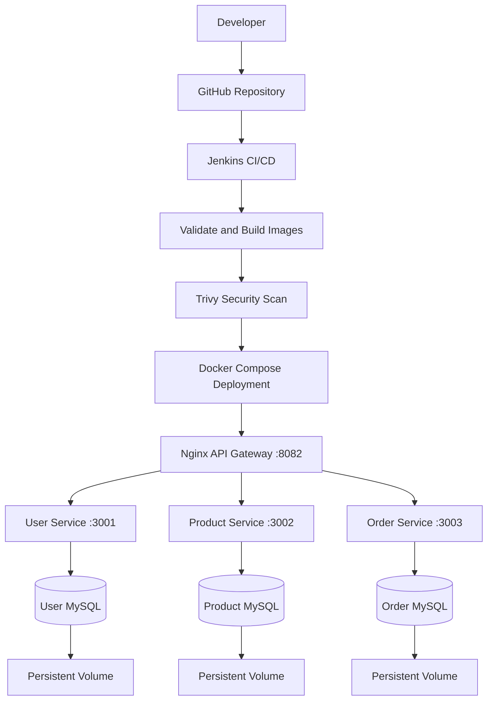

# Three-Microservices CI/CD Automation Project

## 1. Project Overview

This project demonstrates a DevOps CI/CD workflow for a three-microservice application using GitHub, Jenkins, Docker, Docker Compose, Nginx, MySQL and Trivy.

The application consists of three independent Node.js services:

- User Service
- Product Service
- Order Service

Nginx acts as the API Gateway and routes incoming requests to the appropriate service. Each microservice has its own MySQL database with persistent Docker volume storage.

**Current implementation:** Local CI/CD build, security scanning, Docker Compose deployment and application health verification on Windows.

**AWS deployment and centralized monitoring:** Pending implementation.

## 2. Architecture



## 3. Technologies Used

| Technology | Purpose |
|---|---|
| Git and GitHub | Source control |
| Jenkins | CI/CD automation |
| Docker | Application containerization |
| Docker Compose | Multi-container deployment |
| Node.js | Microservices |
| Nginx | API Gateway and reverse proxy |
| MySQL 8.4 | Database |
| Trivy | Container vulnerability scanning |
| PowerShell | Local administration |

## 4. Project Structure

```text
three-microservices-cicd/
│
├── user-service/
│   ├── Dockerfile
│   ├── package.json
│   ├── package-lock.json
│   └── server.js
│
├── product-service/
│   ├── Dockerfile
│   ├── package.json
│   ├── package-lock.json
│   └── server.js
│
├── order-service/
│   ├── Dockerfile
│   ├── package.json
│   ├── package-lock.json
│   └── server.js
│
├── database/
│   └── init.sql
│
├── nginx/
│   └── nginx.conf
│
├── docs/
│   ├── architecture.md
│   ├── deployment-and-rollback.md
│   ├── screenshots/
│   └── trivy-reports/
│
├── jenkins/
├── monitoring/
├── terraform/
│
├── docker-compose.yml
├── Jenkinsfile
└── .gitignore
```

## 5. Local Environment Prerequisites

Install the following tools:

- Git
- Docker Desktop
- Docker Compose
- Jenkins
- Java 21
- Node.js
- Trivy

The current Jenkins pipeline runs on a Windows agent and uses the Trivy executable at:

```text
C:\Tools\Trivy\trivy.exe
```

Adjust this path if Trivy is installed elsewhere.

## 6. Run the Application Locally

Clone the repository:

```powershell
git clone https://github.com/prasanthl14714-wq/three-microservices-cicd.git

cd three-microservices-cicd
```

Validate the Docker Compose configuration:

```powershell
docker-compose config -q
```

Build and start the application:

```powershell
docker-compose up -d --build
```

Check container status:

```powershell
docker-compose ps
```

View application logs:

```powershell
docker-compose logs
```

## 7. Application Endpoints

The API Gateway is exposed on port 8082.

| Endpoint | Description |
|---|---|
| `http://127.0.0.1:8082/health` | API Gateway health |
| `http://127.0.0.1:8082/api/users` | User Service API |
| `http://127.0.0.1:8082/api/products` | Product Service API |
| `http://127.0.0.1:8082/api/orders` | Order Service API |

Test endpoints using PowerShell:

```powershell
curl.exe http://127.0.0.1:8082/health

curl.exe http://127.0.0.1:8082/api/users

curl.exe http://127.0.0.1:8082/api/products

curl.exe http://127.0.0.1:8082/api/orders
```

## 8. Jenkins CI/CD Pipeline

The Jenkins pipeline currently includes these stages:

1. Checkout source code from GitHub.
2. Verify Git, Docker and Docker Compose.
3. Validate Docker Compose configuration.
4. Build the three microservice images.
5. Scan images using Trivy.
6. Deploy application services using Docker Compose.
7. Restart Nginx to refresh upstream connections.
8. Verify application health and API endpoints.
9. Archive Trivy JSON reports.

### Security scanning

Trivy scans the three application images for HIGH and CRITICAL vulnerabilities.

The pipeline uses:

```text
--scanners vuln
--severity HIGH,CRITICAL
--exit-code 1
--format json
```

The pipeline fails when matching HIGH or CRITICAL vulnerabilities are detected.

The final local scan reports recorded in this repository showed:

| Service | HIGH | CRITICAL |
|---|---:|---:|
| User Service | 0 | 0 |
| Product Service | 0 | 0 |
| Order Service | 0 | 0 |

These results describe the saved final reports and do not guarantee that future image builds will have the same findings.

## 9. GitHub Integration

Repository:

https://github.com/prasanthl14714-wq/three-microservices-cicd

Main branch:

```text
main
```

Jenkins Poll SCM is configured with:

```text
H/5 * * * *
```

This checks the repository approximately every five minutes for changes. Automatic triggering still needs to be verified with a new commit.

## 10. Persistent Storage

The application uses three named Docker volumes:

- `user-db-data`
- `product-db-data`
- `order-db-data`

These volumes preserve MySQL database data when containers are recreated.

List Docker volumes:

```powershell
docker volume ls
```

## 11. Deployment and Rollback

The local deployment command is:

```powershell
docker-compose up -d
```

If an application deployment fails, the documented rollback strategy is to restore the previous stable image versions in the deployment configuration and redeploy.

Check the API Gateway health endpoint after recovery:

```powershell
curl.exe http://127.0.0.1:8082/health
```

For detailed instructions, see:

`docs/deployment-and-rollback.md`

## 12. Evidence and Reports

The repository includes:

- Jenkins pipeline success screenshot.
- Docker container status screenshots.
- Trivy security scan screenshots.
- API testing screenshot.
- Trivy JSON vulnerability reports.
- Architecture documentation.
- Deployment and rollback documentation.

Evidence is stored in:

```text
docs/screenshots/
docs/trivy-reports/
```

## 13. AWS Deployment and Monitoring — Pending

The following assignment activities remain to be implemented:

- Terraform infrastructure provisioning.
- AWS EC2 Ubuntu instance.
- Three Amazon ECR repositories.
- IAM role and permissions for ECR access.
- Secure deployment from Jenkins to EC2.
- Versioned Docker image publishing.
- AWS application deployment and verification.
- Prometheus configuration.
- Node Exporter installation.
- Grafana dashboards.
- Monitoring and simulated failure recovery.

The selected AWS region is:

```text
ap-south-1 (Mumbai)
```

AWS resources have not yet been provisioned.

## 14. Security Considerations

- Do not commit `.env` files or credentials.
- Use IAM roles for AWS resource access.
- Store Jenkins credentials in Jenkins Credentials.
- Restrict SSH and administrative access.
- Avoid exposing Jenkins and Grafana publicly.
- Review vulnerability scan results before deployment.
- Configure database passwords securely before AWS deployment.

The current Compose file contains example database passwords and should be updated to use environment-based secrets before production deployment.

## 15. Cleanup

Stop the local Compose application:

```powershell
docker-compose down
```

This stops and removes the Compose containers and network while retaining named database volumes.

**Warning:** Do not use `docker-compose down -v` unless you intentionally want to delete the database volumes and their stored data.

Remove unused dangling images only after reviewing them:

```powershell
docker image ls --filter "dangling=true"

docker image prune
```

---

**Project status:** Local CI/CD implementation and evidence collection completed. AWS infrastructure, AWS deployment and centralized monitoring are pending.
