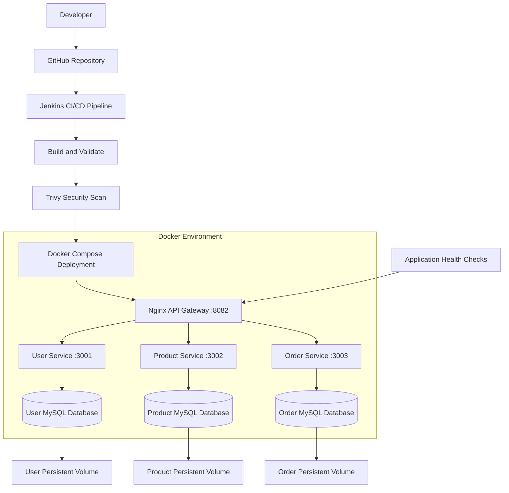

# Three-Tier Microservices CI/CD Architecture

## 1. Project Overview

This project implements a three-tier microservices application using Docker, Docker Compose, Jenkins, GitHub, MySQL, Nginx and Trivy.

## 2. Architecture Diagram

## 3. Three-Tier Architecture

### Presentation / API Gateway Tier
- Nginx API Gateway
- Exposes the application through port 8082
- Routes requests to the appropriate microservice

### Application Tier
- User Service – Port 3001
- Product Service – Port 3002
- Order Service – Port 3003
- Node.js microservices handle application logic and API requests

### Database Tier
- User MySQL Database
- Product MySQL Database
- Order MySQL Database
- Docker named volumes provide persistent storage

## 4. CI/CD Workflow

1. Developer pushes source code to GitHub.
2. Jenkins checks out the repository.
3. Jenkins validates the Docker Compose configuration.
4. Jenkins builds the microservice Docker images.
5. Trivy scans the images for security vulnerabilities.
6. Docker Compose deploys the application.
7. Jenkins checks application health endpoints.

## 5. Technologies Used

- Git and GitHub
- Jenkins
- Docker and Docker Compose
- Node.js
- Nginx
- MySQL 8.4
- Trivy
- PowerShell

## 6. Application Access

API Gateway: http://127.0.0.1:8082

Health Check: http://127.0.0.1:8082/health

Users API: http://127.0.0.1:8082/api/users

Products API: http://127.0.0.1:8082/api/products

Orders API: http://127.0.0.1:8082/api/orders